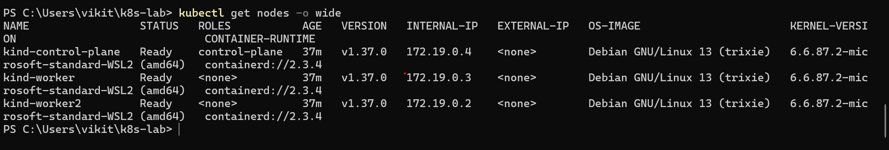
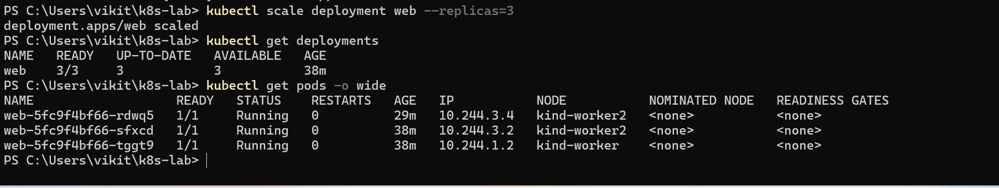
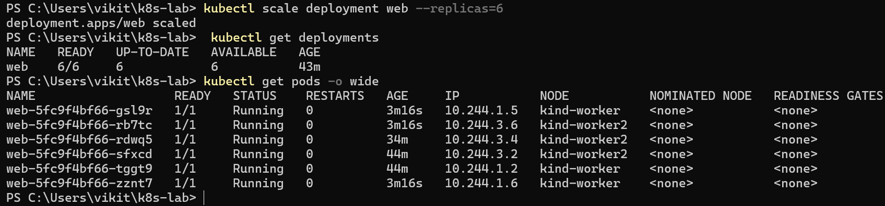
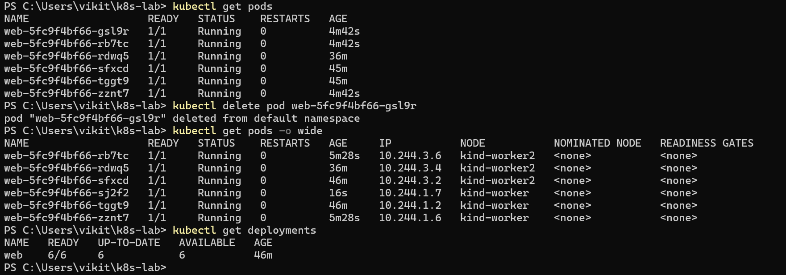

# Kubernetes Cluster Management: Deployment, Scaling & Self-Healing


A hands-on Kubernetes lab demonstrating multi-node cluster provisioning, application deployment, replica scaling, and automated Pod recovery, built with **kind, Docker Desktop, Kubernetes, and NGINX** on Windows.

## Table of Contents

- [Overview](#overview)
- [Objectives](#objectives)
- [Technology Stack](#technology-stack)
- [Cluster Architecture](#cluster-architecture)
- [Prerequisites](#prerequisites)
- [Quick Start](#quick-start)
- [Implementation and Validation](#implementation-and-validation)
- [Results Summary](#results-summary)
- [How Self-Healing Works](#how-self-healing-works)
- [Cleanup](#cleanup)
- [Repository Structure](#repository-structure)
- [Key Learnings](#key-learnings)
- [Conclusion](#conclusion)
- [Future Enhancements](#future-enhancements)

## Overview

This project explores core container orchestration concepts using a local three-node Kubernetes cluster. An NGINX application is deployed through a Kubernetes Deployment, scaled to different replica counts, and tested under a simulated Pod failure.

The lab shows how Kubernetes controllers continuously reconcile the **actual** cluster state with the **desired** configuration to maintain application availability.

## Objectives

- Provision a local Kubernetes cluster with one control-plane node and two worker nodes.
- Deploy and manage an NGINX application using a Deployment.
- Inspect Pod readiness, status, and node placement.
- Scale application replicas from three to six.
- Simulate a Pod failure by manually deleting a running Pod.
- Verify that the desired replica count is restored automatically.

## Technology Stack

| Technology | Purpose |
|---|---|
| Windows 11 | Host environment |
| Docker Desktop | Container runtime environment |
| kind | Local multi-node Kubernetes cluster |
| Kubernetes | Container orchestration |
| `kubectl` | Cluster and workload management |
| NGINX | Sample web application |
| Git and GitHub | Version control and project hosting |

## Cluster Architecture

| Node | Role |
|---|---|
| `kind-control-plane` | Cluster management and scheduling |
| `kind-worker` | Application workload execution |
| `kind-worker2` | Application workload execution |

The cluster topology is defined in [`kind-config.yaml`](kind-config.yaml).

## Prerequisites

- Windows 11 with Docker Desktop installed and running
- [kind](https://kind.sigs.k8s.io/) installed and available in `PATH`
- [kubectl](https://kubernetes.io/docs/tasks/tools/) installed and available in `PATH`
- PowerShell or Windows Terminal

Verify the tools are available:

```powershell
docker --version
kind --version
kubectl version --client
```

## Quick Start

```powershell
# Clone the repository
git clone <repository-url>
cd CC-4-kubernetes-lab-windows

# Create the cluster
kind create cluster --config kind-config.yaml

# Deploy NGINX
kubectl create deployment web --image=nginx --replicas=3
```

## Implementation and Validation

### 1. Cluster Provisioning

Create the cluster from the kind configuration:

```powershell
kind create cluster --config kind-config.yaml
```

Validate connectivity and node readiness:

```powershell
kubectl cluster-info
kubectl get nodes -o wide
```

**Result:** All three nodes reached the `Ready` state.



### 2. NGINX Deployment

Create a Deployment with three replicas:

```powershell
kubectl create deployment web --image=nginx --replicas=3
```

Inspect the Deployment and Pods:

```powershell
kubectl get deployments
kubectl get pods -o wide
```

**Result:** All three Pods reached `Running` with readiness `1/1`.



### 3. Replica Scaling

Scale the Deployment from three to six replicas:

```powershell
kubectl scale deployment web --replicas=6
```

Verify the new replica count:

```powershell
kubectl get deployments
kubectl get pods -o wide
```

**Result:** The Deployment reached `6/6` available replicas, with all six Pods running.



### 4. Pod Deletion and Self-Healing

Delete one running Pod to simulate an individual Pod failure:

```powershell
kubectl delete pod <pod-name>
```

> Replace `<pod-name>` with the name of a Pod belonging to the `web` Deployment.

Monitor the replacement process:

```powershell
kubectl get pods -o wide
kubectl get deployments
```

**Result:** Kubernetes created a replacement Pod, which reached `Running` with readiness `1/1`. The Deployment returned to `6/6` available replicas.



## Results Summary

| Test | Verified Outcome |
|---|---|
| Cluster provisioning | 3 nodes in `Ready` state |
| Initial deployment | 3/3 replicas available |
| Replica scaling | 6/6 replicas available |
| Manual Pod deletion | Completed successfully |
| Replacement Pod creation | Observed |
| Recovery verification | 6/6 replicas available |

## How Self-Healing Works

A Deployment manages a ReplicaSet, which continuously compares the number of running Pods against the desired replica count. When a Pod is deleted, the ReplicaSet controller detects the gap and schedules a replacement Pod, restoring the desired state without manual intervention.

## Cleanup

Remove the Deployment and delete the cluster when finished:

```powershell
kubectl delete deployment web
kind delete cluster
```

## Repository Structure

```text
CC-4-kubernetes-lab-windows/
├── kind-config.yaml
├── README.md
└── screenshots/
    ├── 01-cluster-nodes.png
    ├── 02-nginx-3-replicas.png
    ├── 03-nginx-6-replicas.png
    └── 04-pod-self-healing.png
```

## Key Learnings

- Provisioning and validating a multi-node Kubernetes cluster.
- Managing containerized applications through Deployments.
- Understanding desired replica counts and scaling operations.
- Inspecting workload placement across worker nodes.
- Understanding Kubernetes reconciliation and replacement Pod creation.
- Validating recovery using Pod readiness and Deployment availability.

## Conclusion

This project demonstrates fundamental Kubernetes orchestration capabilities in a local development environment. Through cluster provisioning, NGINX deployment, replica scaling, and Pod deletion, the lab shows how Kubernetes manages application workloads and restores the desired replica count after a Pod is removed.

## Future Enhancements

- Expose NGINX through a Kubernetes Service.
- Implement rolling updates and image-version changes.
- Evaluate behavior during worker-node unavailability.
- Manage the application with declarative Kubernetes manifests.
